    <h3><code>daksh043@github ~ $ ./contributions.sh</code></h3>
    
      
    <h3><code>daksh043@github ~ $ ./skyline-3d --isometric</code></h3>
    
<b>Interactive 3D Contribution Skyline UI</b> built with React, TypeScript, Tailwind CSS &amp; Lucide React icons (<code>LayoutGrid</code>, <code>Box</code>).

     
    <h3><code>daksh043@github ~ $ whoami</code></h3>
    <table>
        <tr>
            <td valign="top"></td>
            <td valign="top"></td>
        </tr>
    </table>

